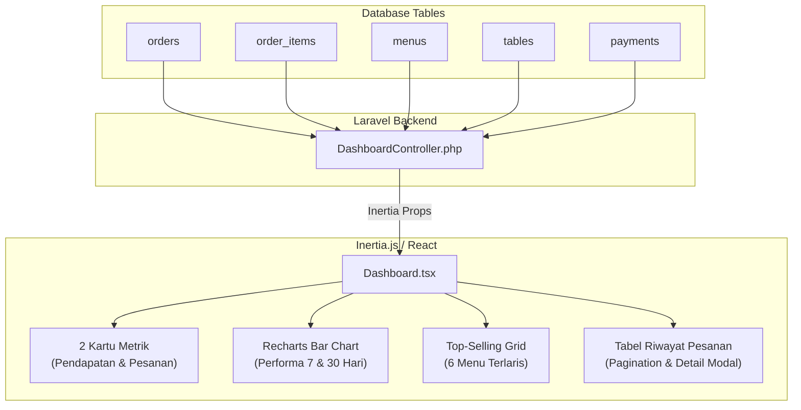

# Panduan & Cara Kerja Halaman Dashboard

Dokumentasi ini menjelaskan secara rinci arsitektur, sumber data nyata dari database, logika perhitungan di backend, serta komponen visual yang digunakan pada halaman **Dashboard** (`Dashboard.tsx`) aplikasi Garis Kota.

---

## 1. Arsitektur & Alur Data

Halaman Dashboard beroperasi dengan prinsip **100% Data Nyata (Real Database-Driven)** tanpa data tiruan/mockup:



---

## 2. Rincian Fitur & Logika Perhitungan Backend

### A. Kartu Metrik Utama (Header Row)
Terdiri dari 2 kartu ringkasan penjualan harian:

1. **Pendapatan Hari Ini**:
   * **Sumber Query**:
     ```php
     $todayRevenue = (float) order::where('order_status', 'completed')
         ->whereDate('created_at', Carbon::today())
         ->sum('total_price');
     ```
   * **Perhitungan Pertumbuhan (% Growth)**:
     Membandingkan omzet hari ini dengan hari kemarin:
     $$\text{Growth} = \frac{\text{Pendapatan Hari Ini} - \text{Pendapatan Kemarin}}{\text{Pendapatan Kemarin}} \times 100\%$$
     Jika kemarin Rp 0 dan hari ini ada pemasukan, bernilai `+100%`.

2. **Pesanan Hari Ini**:
   * **Sumber Query**:
     ```php
     $todayOrdersCount = order::whereDate('created_at', Carbon::today())->count();
     ```
   * **Perhitungan Pertumbuhan**: Menghitung persentase kenaikan/penurunan jumlah order dibanding kemarin.

---

### B. Grafik Performa Penjualan (Recharts)
Menampilkan grafik batang ganda (*grouped bar chart*) interaktif:

* **Pilihan Periode**: Toggle tombol **7 hari** dan **30 hari**.
* **Visualisasi Warna**:
  * 🔴 **Batang Merah (`#D91A20`)**: Total nominal pendapatan per hari.
  * ⚫ **Batang Hitam (`#1e293b`)**: Total volume transaksi/pesanan per hari.
* **Logika Backend**:
  Controller mengulang dari $N$ hari ke belakang hingga hari ini:
  ```php
  $dayOrders = order::whereDate('created_at', $dateStr)->count();
  $dayRevenue = order::where('order_status', 'completed')
      ->whereDate('created_at', $dateStr)
      ->sum('total_price');
  ```
* **Komponen Frontend**: Menggunakan `ResponsiveContainer`, `BarChart`, `Bar`, `XAxis`, `YAxis`, dan custom `Tooltip` dari library **`recharts`**.
* **Dual Y-Axis (Skala Terpisah)**:
  Karena nominal rupiah pendapatan (ribuan hingga jutaan) dan jumlah pesanan (satuan 1-20) memiliki perbedaan skala yang sangat besar, Recharts dikonfigurasi dengan dua sumbu Y:
  - `yAxisId="pendapatan"` di sisi kiri untuk nominal rupiah.
  - `yAxisId="pesanan"` di sisi kanan untuk volume pesanan.
  - Ditambahkan `minPointSize={4}` sehingga batang hitam selalu memiliki tinggi yang proporsional dan tidak gepeng/hilang.

---

### C. Top - Selling Menu
Menampilkan 6 produk yang paling diminati oleh pelanggan dalam bentuk grid 3x2:

* **Logika Query SQL**:
  Melakukan agregasi `SUM(order_items.quantity)` yang terhubung ke menu dan pesanan berstatus selesai (`completed`):
  ```php
  $topSelling = menu::select('menus.id', 'menus.name', 'menus.image', 'menus.price')
      ->selectRaw('COALESCE(SUM(order_items.quantity), 0) as total_sold')
      ->leftJoin('order_items', 'menus.id', '=', 'order_items.menu_id')
      ->leftJoin('orders', function ($join) {
          $join->on('order_items.order_id', '=', 'orders.id')
               ->where('orders.order_status', '=', 'completed');
      })
      ->groupBy('menus.id', 'menus.name', 'menus.image', 'menus.price')
      ->orderByDesc('total_sold')
      ->limit(6)
      ->get();
  ```
* **Tampilan**: Jika menu memiliki gambar di `menus/`, gambar akan otomatis ditampilkan. Jika belum ada, sistem menampilkan placeholder ikon sendok-garpu.

---

### D. Tabel Riwayat Pesanan Terbaru
Menampilkan ringkasan riwayat pesanan pelanggan secara *real-time*:

* **Paginasi Backend**: Dibatasi 3 baris per halaman (`paginate(3)`) sesuai desain layout.
* **Kolom Tabel**:
  1. `PELANGGAN`: Avatar bulat merah + Nama pelanggan (`customer_name`).
  2. `ID`: ID unik pesanan (`#150`).
  3. `PESANAN`: Tombol merah `Detail Pesanan`. Saat diklik, membuka pop-up modal [`OrderDetailModal.tsx`](file:///c:/Users/LENOVO/Downloads/garisKota/resources/js/Components/OrderDetailModal.tsx) berisi item menu, kuantitas, catatan (*notes*), dan status bayar.
  4. `WAKTU`: Format waktu relatif (misal: *8 Menit lalu* via Carbon `diffForHumans`).
  5. `STATUS`: Badge pill hijau `Selesai` atau merah `Dibatalkan`.
* **Komponen Paginasi**: Terhubung langsung ke [`Pagination.tsx`](file:///c:/Users/LENOVO/Downloads/garisKota/resources/js/Components/Pagination.tsx).

---

## 3. Daftar File yang Terlibat

| No   | File                                           | Peran / Deskripsi                                                                   |
| :--- | :--------------------------------------------- | :---------------------------------------------------------------------------------- |
| 1    | `app/Http/Controllers/DashboardController.php` | Mengambil & menghitung seluruh data statistik riil dari database                    |
| 2    | `resources/js/Pages/Dashboard.tsx`             | Halaman antarmuka React (Kartu metrik, Recharts, Top-selling, Tabel)                |
| 3    | `routes/web.php`                               | Mendaftarkan rute `Route::get('/dashboard', [DashboardController::class, 'index'])` |
| 4    | `resources/js/Components/OrderDetailModal.tsx` | Modal popup rincian pesanan saat tombol "Detail Pesanan" diklik                     |
| 5    | `resources/js/Components/Pagination.tsx`       | Komponen navigasi nomor halaman pada footer tabel                                   |
| 6    | `package.json`                                 | Menyimpan dependensi library `recharts`                                             |

---

## 4. Panduan Menjalankan

1. **Install Library Grafik**:
   ```bash
   npm install recharts
   ```
2. **Jalankan Vite Server**:
   ```bash
   npm run dev
   ```
3. **Mengisi Data Contoh Database** *(opsional, untuk mengisi transaksi contoh)*:
   ```bash
   php artisan migrate:fresh --seed
   ```
   *Dashboard akan langsung terisi dengan total pendapatan, grafik 7 hari, menu terlaris, dan tabel riwayat pesanan yang di-generate dari seeder.*

