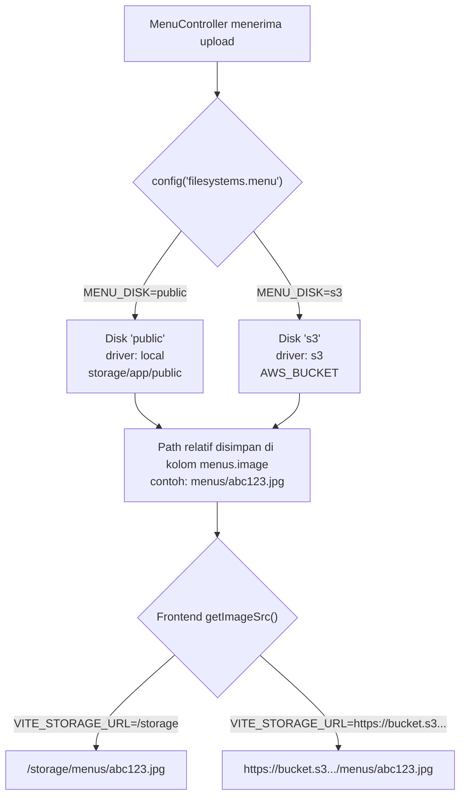

# Dokumentasi Storage Hybrid Gambar Menu (Local & AWS S3)
**Aplikasi POS & Pemesanan Kafe: Garis Kota Workspace & Coffee**

Dokumen ini menjelaskan cara kerja penyimpanan gambar menu yang bisa berpindah antara **disk lokal** dan **AWS S3** hanya dengan mengubah `.env` — tanpa menyentuh kode PHP maupun TypeScript.

---

## 1. Ikhtisar & Latar Belakang

Sebelumnya, `MenuController` menulis nama disk secara **hardcode** di 6 tempat:

```php
$request->file('image')->store('menus', 'public');   // ← literal 'public'
Storage::disk('public')->exists($menu->image);       // ← literal 'public'
Storage::disk('public')->delete($menu->image);       / /← literal 'public'
```

Konsekuensinya, mengisi `AWS_*` di `.env` **tidak akan pernah membuat file pindah ke S3**.

### Kenapa tidak otomatis?

Dua fakta dari source Laravel:

**`Illuminate\Http\UploadedFile::parseOptions()`** — string diubah jadi key `disk`:
```php
if (is_string($options)) {
    $options = ['disk' => $options];   // 'public' jadi NAMA DISK literal
}
```

**`Illuminate\Filesystem\FilesystemManager::disk()`** — default hanya dipakai jika `$name` kosong:
```php
$name = enum_value($name) ?: $this->getDefaultDriver();
//   'public' (truthy) ──┘      ↑ tidak pernah tercapai
```

`getDefaultDriver()` adalah tempat `FILESYSTEM_DISK` dibaca. Karena `'public'` selalu truthy, **`FILESYSTEM_DISK=s3` tidak berpengaruh apa pun** pada kode lama. File tetap tertulis di `storage/app/public`.

---

## 2. Diagram Alur Kerja



**Prinsip penting:** kolom `menus.image` selalu menyimpan **path relatif** (`menus/xxx.jpg`), tidak pernah URL absolut. Dengan begitu file bisa berpindah disk tanpa perlu migrasi data di database.

---

## 3. Komponen & File Terkait

### A. Backend — pemilihan disk

**`config/filesystems.php`** — key konfigurasi baru:
```php
'default' => env('FILESYSTEM_DISK', 'local'),

'menu' => env('MENU_DISK', 'public'),   // ← yang dipakai gambar menu
```

> Key `menu` sengaja dipisah dari `default`. `default` masih `local` (disk privat Laravel) dan dipakai keperluan lain — gambar menu butuh disk yang bisa diakses browser.

**`app/Http/Controllers/MenuController.php`** — 6 hardcode diganti:
```php
// store()
$validated['image'] = $request->file('image')->store('menus', config('filesystems.menu'));

// update() — ganti gambar lama
if ($menu->image && Storage::disk(config('filesystems.menu'))->exists($menu->image)) {
    Storage::disk(config('filesystems.menu'))->delete($menu->image);
}
$validated['image'] = $request->file('image')->store('menus', config('filesystems.menu'));

// update() — centang "hapus gambar"
if ($menu->image && Storage::disk(config('filesystems.menu'))->exists($menu->image)) {
    Storage::disk(config('filesystems.menu'))->delete($menu->image);
}

// destroy()
if ($menu->image && Storage::disk(config('filesystems.menu'))->exists($menu->image)) {
    Storage::disk(config('filesystems.menu'))->delete($menu->image);
}
```

### B. Frontend — pembentukan URL

**`resources/js/lib/utils.ts`**:
```typescript
// Base URL mengikuti MENU_DISK di backend
const STORAGE_BASE = (import.meta.env.VITE_STORAGE_URL as string | undefined) ?? "/storage"

export const getImageSrc = (imagePath?: string): string => {
    if (!imagePath) return ""
    if (imagePath.startsWith("http") || imagePath.startsWith("/")) return imagePath
    return `${STORAGE_BASE.replace(/\/+$/, "")}/${imagePath}`
}
```

Default-nya `/storage`, sehingga **development lokal jalan tanpa konfigurasi tambahan**.

Fungsi ini adalah satu-satunya tempat pembentukan URL gambar. Dua komponen yang sebelumnya menulis logika inline secara duplikat sudah dikonsolidasi memakai `getImageSrc`:
- `Components/MenuFormModal.tsx` (preview gambar saat edit)
- `Components/OrderDetailModal.tsx` (gambar item di rincian pesanan)

> **Jika ada komponen baru yang menampilkan gambar menu, selalu pakai `getImageSrc()` — jangan tulis `/storage/${path}` secara manual.**

### C. Konfigurasi Environment

**`.env.example`**:
```dotenv
# Disk upload gambar menu: "public" (dev lokal, butuh storage:link) atau "s3" (production)
MENU_DISK=public

# Base URL gambar menu di frontend. Ikuti MENU_DISK:
#   MENU_DISK=public -> /storage
#   MENU_DISK=s3     -> https://<bucket>.s3.<region>.amazonaws.com (atau CloudFront/AWS_URL)
VITE_STORAGE_URL=/storage
```

---

## 4. Cara Penggunaan

### A. Development Lokal (default)

```dotenv
MENU_DISK=public
VITE_STORAGE_URL=/storage
```

Jalankan sekali agar symlink `public/storage` → `storage/app/public` terbentuk:

```bash
php artisan storage:link
```

Selesai. Tidak perlu kredensial AWS.

### B. Production dengan AWS S3

**1. Isi `.env`:**
```dotenv
MENU_DISK=s3
VITE_STORAGE_URL=https://garis-kota.s3.ap-southeast-1.amazonaws.com

AWS_ACCESS_KEY_ID=AKIA................
AWS_SECRET_ACCESS_KEY=................
AWS_DEFAULT_REGION=ap-southeast-1
AWS_BUCKET=garis-kota
AWS_USE_PATH_STYLE_ENDPOINT=false
```

> Jika memakai CloudFront atau `AWS_URL`, ganti `VITE_STORAGE_URL` dengan domain tersebut.

**2. Bucket S3 harus public-read** agar gambar bisa ditampilkan langsung:
```json
{
    "Version": "2012-10-17",
    "Statement": [
        {
            "Sid": "PublicReadGetObject",
            "Effect": "Allow",
            "Principal": "*",
            "Action": "s3:GetObject",
            "Resource": "arn:aws:s3:::garis-kota/*"
        }
    ]
}
```

**3. Build ulang frontend** (wajib — Vite meng-inline nilai `VITE_*` saat build):
```bash
npm run build
```

**4. Jalankan test** untuk memastikan tidak ada hardcode yang tertinggal:
```bash
php artisan test
```

### C. Migrasi File yang Sudah Ada

Kolom `menus.image` berisi path relatif, jadi **tidak perlu migrasi database**. Tinggal pindahkan file fisiknya:

```bash
# Contoh: dari local ke S3 (install aws-cli dulu)
aws s3 sync storage/app/public/menus/ s3://garis-kota/menus/
```

Setelah itu kosongkan symlink lama bila tidak dipakai lagi.

---

## 5. Referensi Cepat

| Kebutuhan              | File                                      | Kunci                                    |
| :--------------------- | :---------------------------------------- | :--------------------------------------- |
| Ganti disk penyimpanan | `.env`                                    | `MENU_DISK`                              |
| Ganti base URL gambar  | `.env`                                    | `VITE_STORAGE_URL`                       |
| Definisi disk          | `config/filesystems.php`                  | `disks.public`, `disks.s3`, `menu`       |
| Logika upload/hapus    | `app/Http/Controllers/MenuController.php` | `config('filesystems.menu')`             |
| Logika URL gambar      | `resources/js/lib/utils.ts`               | `getImageSrc()`                          |
| Test anti-hardcode     | `tests/Feature/MenuTest.php`              | `test_image_upload_uses_configured_disk` |

---

## 6. Catatan & Jebakan

1. **`VITE_STORAGE_URL` butuh `npm run build` ulang.** Nilainya di-inline Vite saat build, jadi mengubahnya hanya di `.env` lalu menjalankan `npm run dev` tidak serta-merta berpengaruh pada build produksi.

2. **Jangan simpan URL absolut di database.** Kolom `image` harus tetap path relatif (`menus/xxx.jpg`) agar file bisa berpindah disk tanpa migrasi data.

3. **`Storage::disk('public')` tidak akan pernah mengikuti `FILESYSTEM_DISK`.** Jika menemukan hardcode `disk('public')` di tempat lain, ia tetap menargetkan disk lokal — perlu diganti `config('filesystems.menu')` secara manual.

4. **Alternatif yang lebih kecil (tidak dipakai):** mendefinisikan ulang disk `public` di config supaya driver-nya bisa dipilih env — 0 perubahan di controller. Ditolak karena disk bernama `public` dengan driver `s3` membingungkan pembaca kode. Perbedaan editnya hanya 1 file.

5. **Test yang menjamin tidak ada regresi:** `MenuTest::test_image_upload_uses_configured_disk` meng-set `config(['filesystems.menu' => 'local'])`, meng-upload gambar, lalu memastikan file benar-benar ada di disk `local`. Jika ada yang mengembalikan hardcode `'public'`, test ini gagal.

---

## 7. Pengujian

```bash
# Test khusus storage
php artisan test --filter=MenuTest

# Full suite
php artisan test
```

Hasil terakhir: **78 test passed (276 assertions)**.

Panduan verifikasi manual:

| Langkah | Local                            | S3                                    |
| :------ | :------------------------------- | :------------------------------------ |
| 1       | Set `MENU_DISK=public`           | Set `MENU_DISK=s3` + isi `AWS_*`      |
| 2       | `php artisan storage:link`       | Set `VITE_STORAGE_URL`                |
| 3       | `npm run dev`                    | `npm run build`                       |
| 4       | Upload menu di `/dashboard/menu` | Upload menu di `/dashboard/menu`      |
| 5       | Cek gambar tampil di list menu   | Cek gambar tampil + ada di console S3 |

---
