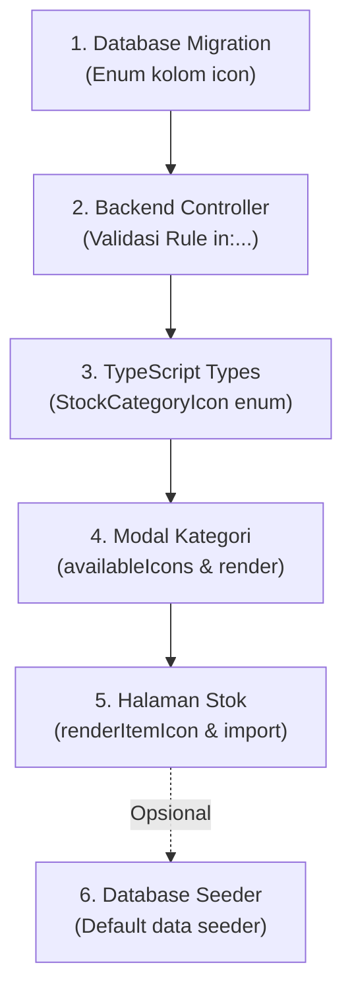

# Panduan Menambahkan Ikon Baru pada Kategori Stok

Dokumentasi ini menjelaskan secara rinci seluruh file dan baris kode yang harus disesuaikan apabila Anda ingin menambahkan pilihan ikon baru untuk kategori stok/bahan baku restoran Garis Kota.

Sebagai contoh, kita asumsikan ingin menambahkan ikon baru: **Teh (`tea`)** menggunakan ikon `Coffee` / `Leaf` / `Cup` dari `lucide-react`.

---

## Ringkasan Alur Perubahan



---

## Daftar File yang Perlu Diubah

### 1. Migrasi Database
* **Lokasi File**: [`database/migrations/2026_11_06_100001_create_stock_categories_table.php`]
* **Tujuan**: Mendaftarkan string pengenal ikon baru ke dalam definisi kolom `enum` database.
* **Kode**:
  ```php
  // Tambahkan nilai baru (misal: 'tea') ke dalam array enum:
  $table->enum('icon', [
      'coffee',
      'milk',
      'droplet',
      'cup',
      'food',
      'package',
      'tea', // <-- Tambahkan di sini
  ])->default('package');
  ```
  > [!NOTE]
  > Jika database sudah berstatus *production*, buat file migrasi baru untuk mengubah enum menggunakan `$table->enum(...)->change();` atau jalankan `php artisan migrate:fresh --seed` di tahap *development*.

---

### 2. Validasi Controller Backend
* **Lokasi File**: [`app/Http/Controllers/StockCategoryController.php`]
* **Tujuan**: Mengizinkan ikon baru tersebut lolos validasi saat pengguna menyimpan atau memperbarui kategori.
* **Kode** (pada method `store` dan `update`):
  ```php
  $validated = $request->validate([
      'name' => 'required|string|max:100|unique:stock_categories,name',
      // Tambahkan nilai baru pada rule in:
      'icon' => 'nullable|in:coffee,milk,droplet,cup,food,package,tea',
  ]);
  ```

---

### 3. Tipe Data TypeScript
* **Lokasi File**: [`resources/js/types/dashboard.d.ts`]
* **Tujuan**: Menjamin keamanan tipe (*type safety*) dan *autocomplete* di frontend TypeScript.
* **Kode**:
  ```typescript
  export type StockCategoryIcon =
      | "coffee"
      | "milk"
      | "droplet"
      | "cup"
      | "food"
      | "package"
      | "tea"; // <-- Tambahkan union type di sini
  ```

---

### 4. Komponen Modal Kategori (`StockCategoryModal.tsx`)
* **Lokasi File**: [`resources/js/Components/StockCategoryModal.tsx`]
* **Tujuan**: Menampilkan ikon pada tombol *Icon Picker* visual dan saat merender daftar kategori.
* **Langkah-langkah**:
  1. **Import Ikon dari Lucide** (pada bagian atas file):
     ```tsx
     import {
         // ... ikon lain
         Leaf, // contoh ikon baru untuk teh
     } from "lucide-react";
     ```
  2. **Daftarkan pada Array `availableIcons`**:
     ```tsx
     const availableIcons: { id: StockCategoryIcon; label: string; icon: React.ComponentType<{ className?: string }> }[] = [
         { id: "coffee", label: "Kopi", icon: Coffee },
         { id: "milk", label: "Susu", icon: Milk },
         { id: "droplet", label: "Sirup", icon: Droplet },
         { id: "cup", label: "Kemasan", icon: CupSoda },
         { id: "food", label: "Makanan", icon: Utensils },
         { id: "package", label: "Lainnya", icon: Package },
         { id: "tea", label: "Teh", icon: Leaf }, // <-- Tambahkan di sini
     ];
     ```
  3. **Tambahkan Case pada Fungsi `renderIconComponent`**:
     ```tsx
     const renderIconComponent = (iconId?: string, className: string = "size-4 text-[#ef4444]") => {
         switch (iconId) {
             case "coffee":
                 return <Coffee className={className} />;
             case "milk":
                 return <Milk className={className} />;
             // ...
             case "tea":
                 return <Leaf className={className} />; // <-- Tambahkan di sini
             default:
                 return <Package className={className} />;
         }
     };
     ```

---

### 5. Halaman Utama Stok (`Stok.tsx`)
* **Lokasi File**: [`resources/js/Pages/Stok.tsx`]
* **Tujuan**: Menampilkan ikon pada tabel daftar bahan baku yang terhubung dengan kategori tersebut.
* **Langkah-langkah**:
  1. **Import Ikon**:
     ```tsx
     import {
         // ...
         Leaf,
     } from "lucide-react";
     ```
  2. **Tambahkan Case pada Fungsi `renderItemIcon`**:
     ```tsx
     const renderItemIcon = (type?: string) => {
         switch (type) {
             case "coffee":
                 return <Coffee className="w-5 h-5 text-[#ef4444]" />;
             // ...
             case "tea":
                 return <Leaf className="w-5 h-5 text-[#ef4444]" />; // <-- Tambahkan di sini
             default:
                 return <Package className="w-5 h-5 text-[#ef4444]" />;
         }
     };
     ```

---

### 6. Database Seeder (Opsional)
* **Lokasi File**: [`database/seeders/DatabaseSeeder.php`]
* **Tujuan**: Memberikan nilai awal pada database saat menjalankan `php artisan db:seed`.
* **Kode**:
  ```php
  $catTeh = StockCategory::firstOrCreate(
      ['name' => 'Teh & Herbal'],
      ['icon' => 'tea']
  );
  ```

---

## Tabel Ceklis Verifikasi Cepat

|  No   | File                                                  | Bagian yang Diubah                                       |
| :---: | :---------------------------------------------------- | :------------------------------------------------------- |
|   1   | `2026_11_06_100001_create_stock_categories_table.php` | Nilai array `$table->enum('icon', [...])`                |
|   2   | `StockCategoryController.php`                         | Validasi rule `'icon' => 'nullable\|in:...'`             |
|   3   | `dashboard.d.ts`                                      | Type `StockCategoryIcon`                                 |
|   4   | `StockCategoryModal.tsx`                              | Import ikon, `availableIcons`, dan `renderIconComponent` |
|   5   | `Stok.tsx`                                            | Import ikon dan `renderItemIcon`                         |
|   6   | `DatabaseSeeder.php` *(opsional)*                     | Inisialisasi seeder kategori bahan baru                  |
