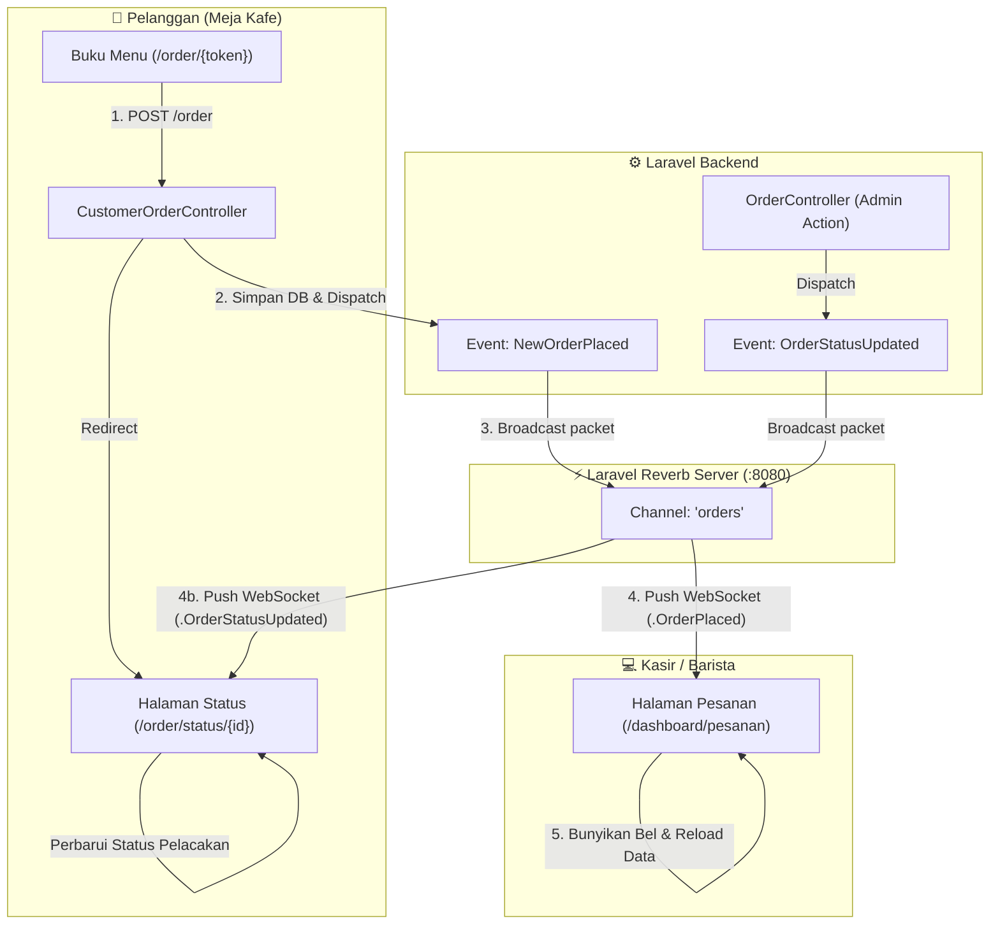

# Dokumentasi Sistem Realtime WebSocket (Laravel Reverb)
**Aplikasi POS & Pemesanan Kafe: Garis Kota Workspace & Coffee**

Dokumen ini menjelaskan arsitektur, alur kerja, struktur kode, dan panduan pengoperasian sistem pembaruan *realtime* berbasis **Laravel Reverb (WebSocket)** dan **Laravel Echo** pada aplikasi Garis Kota.

---

## 1. Ikhtisar & Latar Belakang

Sebelumnya, sistem pelacakan pesanan menggunakan *HTTP Auto-Polling* (`setInterval` tiap 5 detik) di sisi frontend. Hal ini menyebabkan:
- Spam request terus-menerus di log terminal server (`/dashboard/pesanan`).
- Beban server meningkat walaupun tidak ada pesanan baru.
- Adanya jeda waktu (latensi hingga 5 detik) sebelum pesanan baru terdeteksi.

Dengan **Laravel Reverb**:
- **Zero Polling Spam**: Server hening 100% tanpa request berulang saat tidak ada transaksi.
- **Respon Instan (< 50ms)**: Begitu pelanggan klik *"Pesan Sekarang"*, layar kasir langsung merespons detik itu juga.
- **Two-Way Status Flow**: Perubahan status oleh kasir (*Terima Pesanan* / *Selesai*) juga langsung tersiar ke layar HP pelanggan secara *live*.

---

## 2. Diagram Alur Kerja (Workflow)



---

## 3. Konfigurasi Lingkungan (`.env`)

Konfigurasi Reverb telah diatur di dalam file `.env`:

```dotenv
# Driver Broadcast utama
BROADCAST_CONNECTION=reverb

# Kredensial Reverb Server
REVERB_APP_ID=776584
REVERB_APP_KEY=9gql1m7vrxk3s21d5zlz
REVERB_APP_SECRET=jgckivn01m07h0gt1n9n
REVERB_HOST="localhost"
REVERB_PORT=8080
REVERB_SCHEME=http

# Variabel Frontend Vite
VITE_REVERB_APP_KEY="${REVERB_APP_KEY}"
VITE_REVERB_HOST="${REVERB_HOST}"
VITE_REVERB_PORT="${REVERB_PORT}"
VITE_REVERB_SCHEME="${REVERB_SCHEME}"
```

---

## 4. Rincian Komponen & File Terkait

### A. Backend Events (`app/Events/`)

1. **`App\Events\NewOrderPlaced.php`**:
   - Di-trigger saat pesanan baru berhasil dibuat oleh pelanggan.
   - Mengimplementasikan `ShouldBroadcastNow` agar langsung dipancarkan tanpa menunggu antrean queue database.
   - Mengirim event `.OrderPlaced` ke public channel `orders`.
   - Payload: `id`, `customer_name`, `table_number`, `total_price`, `status`, `created_at`.

2. **`App\Events\OrderStatusUpdated.php`**:
   - Di-trigger saat status pesanan berubah (*pending* ➔ *processing* ➔ *completed* / *cancelled*).
   - Mengirim event `.OrderStatusUpdated` ke public channel `orders`.
   - Payload: `id`, `status`, `table_number`, `action`.

### B. Controller (`app/Http/Controllers/`)

- **`CustomerOrderController.php`**:
  - `store()`: Menyimpan pesanan dan memanggil `NewOrderPlaced::dispatch($order)`.
  - `cancel()`: Membatalkan pesanan dan memanggil `OrderStatusUpdated::dispatch($order, 'cancelled')`.
- **`OrderController.php`**:
  - `process()`: Mengubah status ke `processing` dan memanggil `OrderStatusUpdated::dispatch($order, 'processing')`.
  - `complete()`: Menyelesaikan pesanan dan memanggil `OrderStatusUpdated::dispatch($order, 'completed')`.
  - `cancel()`: Membatalkan pesanan dan memanggil `OrderStatusUpdated::dispatch($order, 'cancelled')`.

*Catatan: Seluruh pemanggilan event dibungkus dalam blok `try-catch` sehingga jika Reverb server belum dinyalakan, proses simpan data tidak akan pernah gagal (tetap aman).*

### C. Frontend React (`resources/js/`)

1. **`resources/js/app.tsx`**:
   - Menginisialisasi `configureEcho` dari `@laravel/echo-react` dengan broadcaster `'reverb'`.
2. **`resources/js/Pages/Pesanan.tsx` (Layar Kasir)**:
   - Terhubung ke `echo().channel('orders')`.
   - Mendengarkan `.OrderPlaced`: memutar nada dering kafe (*Web Audio API* 3-tone arpeggio mayor), memunculkan banner alert merah, dan me-reload data tabel secara instan.
   - Mendengarkan `.OrderStatusUpdated`: me-reload data secara instan tanpa spam HTTP.
3. **`resources/js/Pages/Customer/OrderStatus.tsx` (Layar HP Pelanggan)**:
   - Terhubung ke `echo().channel('orders')`.
   - Mendengarkan `.OrderStatusUpdated`: jika `order.id` cocok dengan pesanan pelanggan, halaman pelacakan otomatis diperbarui (dari *Diterima* ➔ *Diracik* ➔ *Selesai*).

---

## 5. Cara Menjalankan Aplikasi

Anda dapat menjalankan seluruh layanan (Web Server, Queue, Reverb WebSocket, dan Vite) sekaligus hanya dengan **1 perintah** melalui Composer:

```bash
composer apaja
```

Perintah di atas akan menjalankan secara bersamaan:
1. `server`: `php artisan serve` (Port 8000)
2. `queue`: `php artisan queue:listen`
3. `reverb`: `php artisan reverb:start` (Port 8080)
4. `vite`: `npm run dev` (Port 5173)

Jika salah satu proses dihentikan (Ctrl + C), seluruh proses lainnya akan ditutup secara otomatis (`--kill-others`).

---

## 6. Pengujian Realtime

1. Jalankan `composer apaja` di terminal Anda.
2. Buka halaman admin: `http://localhost:8000/dashboard/pesanan`.
   - Pastikan badge di kanan atas menampilkan status **`Reverb: Realtime`** dengan lampu hijau aktif.
3. Buka tab baru / HP ke halaman pemesanan pelanggan (contoh: `http://localhost:8000/order/{token}`).
4. Tambahkan menu dan lakukan *Checkout*.
5. Amati:
   - Terminal `php artisan serve` tidak ada spam log berkala.
   - Layar admin langsung berbunyi bel notifikasi dan kartu pesanan baru muncul seketika di posisi atas.
   - Di layar admin klik **"Terima Pesanan"** ➔ layar HP pelanggan otomatis berubah menjadi *"Sedang Diracik"*.
