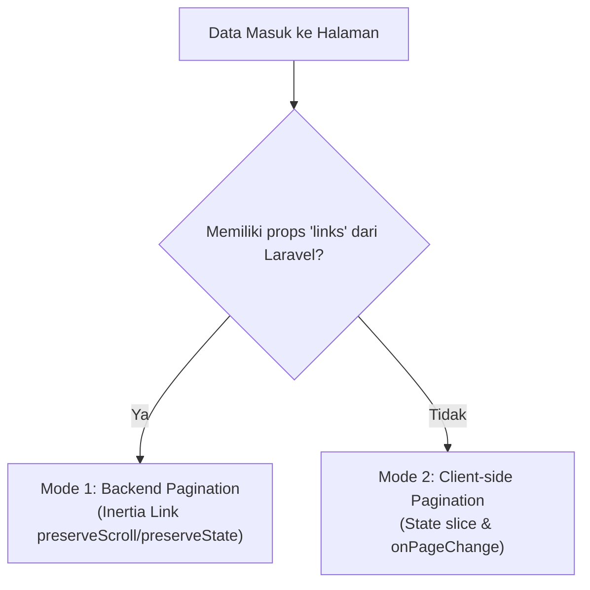

# Panduan & Dokumentasi Komponen Pagination

Dokumentasi ini menjelaskan arsitektur, spesifikasi teknis, serta cara penggunaan komponen reusable **Pagination** (`Pagination.tsx`) pada aplikasi Garis Kota, baik secara **Backend-driven (Laravel Eloquent Paginator)** maupun **Client-side (Frontend State)**.

---

## 1. Lokasi & Arsitektur Komponen

* **Komponen**: `resources/js/Components/Pagination.tsx`
* **TypeScript Interface**: `resources/js/types/dashboard.d.ts` (`PaginatedData<T>`)

Komponen ini dirancang dengan konsep **Hybrid**, artinya dapat beroperasi dalam dua mode:



---

## 2. Spesifikasi Props (`PaginationProps`)

```typescript
export interface PaginationLink {
    url: string | null;  // URL endpoint halaman (null jika tombol nonaktif)
    label: string;        // Angka atau label navigasi ("Previous", "Next", dll)
    active: boolean;      // True jika merupakan halaman aktif saat ini
}

interface PaginationProps {
    // Mode 1: Backend Laravel LengthAwarePaginator links
    links?: PaginationLink[];

    // Mode 2: Client-side / fallback pagination
    currentPage?: number;
    totalPages?: number;
    onPageChange?: (page: number) => void;

    // Keterangan teks info (Menampilkan X - Y dari Z data)
    from?: number;
    to?: number;
    total?: number;
    itemName?: string; // default: "data" (misal: "menu", "bahan", "meja", "kategori")
}
```

---

## 3. Cara Penggunaan

### A. Mode Backend (Laravel Controller + Inertia.js)

Gunakan mode ini ketika data di-paginate langsung dari database menggunakan query Eloquent. Sangat disarankan untuk data berjumlah besar.

#### 1. Pada Controller Laravel:
Gunakan method `paginate($perPage)` pada query model Anda, lalu format data menggunakan `through()`:

```php
// Contoh pada app/Http/Controllers/StockController.php:
public function index()
{
    $stocks = Stock::with('stockCategory')
        ->orderBy('id', 'asc')
        ->paginate(8)               // <- Jumlah data per halaman
        ->withQueryString()         // <- Mempertahankan parameter filter/search di URL
        ->through(function ($item) {
            return [
                'id' => $item->id,
                'name' => $item->name,
                // field lainnya...
            ];
        });

    return inertia('Stok', [
        'stockItems' => $stocks,
    ]);
}
```

> [!NOTE]
> Laravel secara otomatis mengirimkan struktur JSON berisi:
> `{ data: [...], current_page: 1, from: 1, to: 8, total: 24, links: [{ url, label, active }] }`.

#### 2. Pada Komponen Halaman React:
Terima data paginasi dan hubungkan ke komponen `Pagination`:

```tsx
import Pagination from "@/Components/Pagination";
import { PaginatedData, StockItem } from "@/types/dashboard";

interface Props {
    stockItems: PaginatedData<StockItem>;
}

export default function Stok({ stockItems }: Props) {
    return (
        <div>
            {/* Tabel merender stockItems.data */}
            <table>
                <tbody>
                    {stockItems.data.map((item, index) => (
                        <tr key={item.id}>
                            <td>{(stockItems.from || 1) + index}</td>
                            <td>{item.name}</td>
                        </tr>
                    ))}
                </tbody>
            </table>

            {/* Pagination Component */}
            <Pagination
                links={stockItems.links}
                from={stockItems.from}
                to={stockItems.to}
                total={stockItems.total}
                itemName="bahan"
            />
        </div>
    );
}
```

---

### B. Mode Client-Side (Fallback / Array Lokal)

Gunakan mode ini jika data yang diterima dari backend berupa array utuh atau state lokal (misalnya daftar yang difilter di sisi browser).

#### 1. Setup State & Perhitungan Slicing:
```tsx
import { useState, useEffect } from "react";
import Pagination from "@/Components/Pagination";

export default function Menu({ menus }) {
    const [currentPage, setCurrentPage] = useState(1);
    const [searchQuery, setSearchQuery] = useState("");
    const itemsPerPage = 8;

    // Filter data
    const filteredItems = menus.filter((item) =>
        item.name.toLowerCase().includes(searchQuery.toLowerCase())
    );

    // Reset ke halaman 1 setiap kali query pencarian berubah
    useEffect(() => {
        setCurrentPage(1);
    }, [searchQuery]);

    // Kalkulasi Halaman
    const totalPages = Math.ceil(filteredItems.length / itemsPerPage) || 1;
    const startIndex = (currentPage - 1) * itemsPerPage;
    const paginatedItems = filteredItems.slice(startIndex, startIndex + itemsPerPage);

    return (
        <div>
            {/* Tabel merender paginatedItems */}
            <table>
                <tbody>
                    {paginatedItems.map((item, i) => (
                        <tr key={item.id}>
                            <td>{startIndex + i + 1}</td>
                            <td>{item.name}</td>
                        </tr>
                    ))}
                </tbody>
            </table>

            {/* Pagination Component */}
            <Pagination
                currentPage={currentPage}
                totalPages={totalPages}
                from={filteredItems.length > 0 ? startIndex + 1 : 0}
                to={Math.min(startIndex + itemsPerPage, filteredItems.length)}
                total={filteredItems.length}
                itemName="menu"
                onPageChange={(page) => setCurrentPage(page)}
            />
        </div>
    );
}
```

---

## 4. Daftar Halaman yang Telah Menggunakan Komponen Ini

| Halaman            | File                              | Mode Utama                                       | Keterangan `itemName` |
| :----------------- | :-------------------------------- | :----------------------------------------------- | :-------------------- |
| **Stok**           | `resources/js/Pages/Stok.tsx`     | **Hybrid** (Backend `paginate(8)` & Client-side) | `itemName="bahan"`    |
| **Manajemen Menu** | `resources/js/Pages/Menu.tsx`     | Client-side (8 item/page)                        | `itemName="menu"`     |
| **Kategori**       | `resources/js/Pages/Kategori.tsx` | Client-side (8 item/page)                        | `itemName="kategori"` |
| **Manajemen Meja** | `resources/js/Pages/Meja.tsx`     | Client-side (8 item/page)                        | `itemName="meja"`     |

---

## 5. Urutan Menambahkan Pagination ke Halaman Baru
*(Contoh: Pesanan, Riwayat Pesanan, atau Pendapatan)*

1. **Import Komponen**:
   ```tsx
   import Pagination from "@/Components/Pagination";
   ```
2. **Definisikan State Halaman**:
   ```tsx
   const [currentPage, setCurrentPage] = useState(1);
   const itemsPerPage = 8;
   ```
3. **Tambahkan `useEffect` Reset**:
   ```tsx
   useEffect(() => {
       setCurrentPage(1);
   }, [searchQuery, filterStatus]);
   ```
4. **Hitung Data yang Ditampilkan**:
   ```tsx
   const totalPages = Math.ceil(filteredItems.length / itemsPerPage) || 1;
   const startIndex = (currentPage - 1) * itemsPerPage;
   const paginatedItems = filteredItems.slice(startIndex, startIndex + itemsPerPage);
   ```
5. **Ganti Loop Tabel**:
   Ubah dari `filteredItems.map(...)` menjadi `paginatedItems.map(...)`, dan tampilkan nomor urut dengan `{startIndex + i + 1}`.
6. **Pasang Komponen `<Pagination />`** di bagian bawah container tabel.

