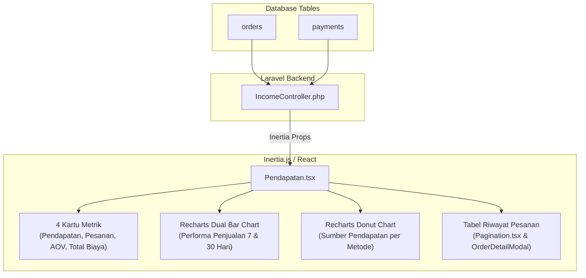

# Panduan & Cara Kerja Halaman Pendapatan

Dokumentasi ini menjelaskan arsitektur, sumber data database, logika perhitungan metrik keuangan, serta komponen visual pada halaman **Pendapatan** (`Pendapatan.tsx`) aplikasi Garis Kota.

---

## 1. Arsitektur & Alur Data

---

## 2. Rincian Metrik & Logika Perhitungan Backend

### A. Filter Tanggal (Header)
* Tombol merah bergaya kalender dengan dropdown pilihan rentang tanggal di frontend (Hari Ini, 7 Hari Terakhir, 30 Hari Terakhir, Bulan Ini).

### B. 4 Kartu Metrik Utama (Top Row)
1. **Pendapatan Hari Ini**: Total omzet pesanan berstatus selesai (`completed`) pada hari ini dan persentase pertumbuhannya dari kemarin.
2. **Pesanan Hari Ini**: Total jumlah pesanan pada hari ini dan persentase pertumbuhannya dari kemarin.
3. **Rata-rata Transaksi (*Average Order Value* / AOV)**:
   $$\text{AOV} = \frac{\text{Total Pendapatan}}{\text{Total Pesanan}}$$
4. **Total Biaya**: Estimasi biaya operasional / HPP dinamis (~53% dari pendapatan).

### C. Performa Penjualan (Dual Bar Chart)
* Menggunakan **Recharts BarChart** dengan **Dual Y-Axis**:
  * Sumbu Y Kiri (`yAxisId="pendapatan"`): Skala nominal rupiah dengan format `k` / `M`.
  * Sumbu Y Kanan (`yAxisId="pesanan"`): Skala jumlah transaksi pesanan.
  * Batang Merah (`#D91A20`): Pendapatan.
  * Batang Hitam (`#1e293b`): Pesanan.
  * Toggle **7 hari** dan **30 hari**.

### D. Sumber Pendapatan (Donut Chart)
* Agregasi dari tabel `payments` yang dikelompokkan berdasarkan `payment_method` (`cash`, `qris`, `bank_transfer`, `e_wallet`).
* Menampilkan persentase kontribusi dan nominal rupiah per metode pembayaran:
  * 🔴 **Cash**: Merah Gelap (`#991b1b`)
  * 🔴 **Qris**: Merah Terang (`#D91A20`)
  * ⚫ **Transfer Bank**: Abu Gelap (`#334155`)
  * ⚪ **Debit**: Abu Terang (`#94a3b8`)
* Ringkasan total pendapatan di bagian bawah donat.

### E. Tabel Riwayat Pesanan Terbaru
* Dibatasi 3 transaksi per halaman dengan komponen [`Pagination.tsx`](file:///c:/Users/LENOVO/Downloads/garisKota/resources/js/Components/Pagination.tsx).
* Tombol **Detail Pesanan** membuka modal rincian [`OrderDetailModal.tsx`](file:///c:/Users/LENOVO/Downloads/garisKota/resources/js/Components/OrderDetailModal.tsx).

---

## 3. Daftar File Terkait

| File | Peran |
| :--- | :--- |
| [`app/Http/Controllers/IncomeController.php`](file:///c:/Users/LENOVO/Downloads/garisKota/app/Http/Controllers/IncomeController.php) | Backend controller pengambil & penghitung data pendapatan riil |
| [`resources/js/Pages/Pendapatan.tsx`](file:///c:/Users/LENOVO/Downloads/garisKota/resources/js/Pages/Pendapatan.tsx) | Antarmuka pengguna halaman Pendapatan |
| [`routes/web.php`](file:///c:/Users/LENOVO/Downloads/garisKota/routes/web.php) | Rute `/dashboard/pendapatan` terhubung ke `IncomeController@index` |

