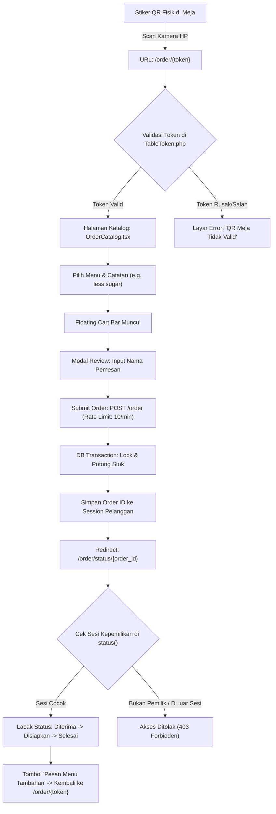

# Dokumentasi Teknis: Sistem QR Code & Routing Pemesanan Pelanggan

Dokumentasi ini menjelaskan secara mendalam bagaimana sistem **QR Code Meja**, algoritma tokenisasi meja, arsitektur routing publik, mekanisme keamanan anti-spoofing, serta alur navigasi pelanggan pada aplikasi **Garis Kota**.

---

## 1. Arsitektur QR Meja & Alur Navigasi

Setiap meja fisik di cafe Garis Kota memiliki stiker QR Code unik. Saat pelanggan memindai QR Code tersebut menggunakan kamera smartphone, mereka langsung diarahkan ke katalog pemesanan yang otomatis terikat dengan nomor meja tempat mereka duduk.



---

## 2. Mekanisme Enkripsi Token Meja (TableToken.php)

> [!IMPORTANT]
> **Mengapa Tidak Menggunakan ID Meja Langsung (`/order/1`)?**
> Jika rute hanya menggunakan ID integer sekuensial biasa:
> 1. Pelanggan nakal di luar cafe bisa membuka `/order/2` dan memesan makanan fiktif atas nama meja lain yang sedang diduduki tamu lain.
> 2. Sangat mudah dilakukan *scraping* atau enumerasi meja.
> 
> Karena itu, sistem menggunakan format token terenkripsi: `{encodedId}-{hash}` (contoh: `1-a3f9c2`).

### A. Algoritma Pembuatan Token (`generate`)
1. **Numeric Salt**: Menggunakan hash SHA-256 dari deret angka rahasia internal:
   ```php
   private static function getSalt(): string
   {
       $numericSeed = '20261114987654321';
       return hash('sha256', $numericSeed);
   }
   ```
2. **Kombinasi Base36 + Hash Checksum**:
   ```php
   public static function generate(int $tableId): string
   {
       $hash = substr(hash('sha256', $tableId . self::getSalt()), 0, 6);
       $encodedId = base_convert((string) $tableId, 10, 36);
       return $encodedId . '-' . $hash;
   }
   ```
   * *Contoh Meja ID 1*: `1-8f4a2b`
   * *Contoh Meja ID 15*: `f-c7d91e`

### B. Algoritma Verifikasi Token (`resolve`)
1. Memecah string token menjadi `$tableId` (dikonversi kembali dari basis 36 ke basis 10) dan `$expectedHash`.
2. Menghitung ulang hash menggunakan salt yang sama dan membandingkannya menggunakan `hash_equals()` untuk mencegah *timing attack*:
   ```php
   if (hash_equals($expectedHash, $parts[1])) {
       return Table::find((int) $tableId);
   }
   ```
3. **Pembedaan Mode Local vs Production**:
   ```php
   // Fallback angka langsung HANYA aktif saat testing di lokal
   if (is_numeric($identifier) && app()->environment('local', 'testing')) {
       return Table::find((int) $identifier);
   }
   ```
   Di komputer developer, pengujian bisa cepat dengan `/order/1`. Namun di server production, sistem otomatis menolak akses angka langsung demi keamanan meja fisik.

---

## 3. Peta Routing & Kebijakan Keamanan (routes/web.php)

Berikut adalah daftar endpoint publik yang berhubungan dengan alur pelanggan:

| Metode | URL Route | Nama Route | Middleware / Proteksi | Deskripsi |
| :--- | :--- | :--- | :--- | :--- |
| `GET` | `/` | `home` | - | **Landing Page Utama**: Halaman selamat datang dengan tipografi interaktif `VariableProximity` dan panduan scan QR. |
| `GET` | `/order/{token}` | `order.show` | `throttle:60,1` | **Katalog Menu Meja**: Menampilkan menu aktif cafe sesuai nomor meja yang valid dari scan QR. |
| `POST` | `/order` | `order.store` | `throttle:10,1`, CSRF | **Submit Pesanan**: Validasi input, atomic database transaction, pemotongan stok menu, dan pencatatan sesi pemesan. |
| `GET` | `/order/status/{order}` | `order.status` | `throttle:60,1`, Session Check | **Pelacakan Status Pesanan**: Menampilkan progres pesanan yang hanya dapat dilihat oleh pembuat pesanan di perangkat tersebut atau staf kasir login. |

### Detail Proteksi Middleware:
1. **Rate Limiting Anti-Spam (`throttle:10,1`)**:
   - Membatasi pelanggan/bot maksimal melakukan 10 kali submit pesanan per menit per alamat IP. Mencegah serangan *denial-of-inventory* (menghabiskan stok menu dengan pesanan fiktif).
2. **Proteksi Akses Status Berbasis Sesi**:
   - Saat order berhasil disubmit di `CustomerOrderController@store`, ID pesanan disimpan ke sesi browser:
     ```php
     $placedOrders = session('placed_orders', []);
     $placedOrders[] = $order->id;
     session(['placed_orders' => array_unique($placedOrders)]);
     ```
   - Pada rute `order.status`, controller memvalidasi kepemilikan:
     ```php
     $isOwner = in_array($order->id, session('placed_orders', []));
     $isStaff = auth()->check();

     if (!$isOwner && !$isStaff && !app()->environment('local', 'testing')) {
         abort(403, 'Anda tidak memiliki akses untuk melihat status pesanan ini.');
     }
     ```

---

## 4. Siklus Pengalaman Pengguna (Customer UX Journey)

### Tahap 1: Scan QR di Meja
1. Pelanggan membuka kamera smartphone dan mengarahkan ke QR stiker meja.
2. Browser membuka `https://gariskota.com/order/{token}`.
3. Jika token valid: Halaman menampilkan header kartu **"Meja 03 (Area Indoor)"** dengan status koneksi aktif.
4. Jika token tidak valid / rusak: Sistem menampilkan layar ramah pengguna dengan pesan *"QR Meja Tidak Valid"* dan petunjuk scan ulang.

### Tahap 2: Memilih Menu & Keranjang
1. Pelanggan dapat mencari menu dengan *search bar sticky* atau memilih kategori (*Makanan*, *Minuman*, *Snack*).
2. Tombol mengambang bulat merah **"Menu"** di tengah bawah memungkinkan pelanggan melompat langsung ke kategori yang diinginkan.
3. Menekan tombol `+ Tambah` mengubah tombol menjadi stepper kuantitas `[-] 1 [+]`.
4. Bar mengambang hijau (*Floating Cart Bar*) muncul di bawah layar menampilkan `1 item | Garis Kota Meja #03 | Rp XX.XXX -> [Icon Tas]`.

### Tahap 3: Review & Submit Pesanan (Checkout)
1. Pelanggan mengetuk bar hijau untuk membuka *Order Checkout Modal*.
2. Pelanggan memasukkan **Nama Pemesan** (satu-satunya data yang wajib diisi, bebas hambatan tanpa login).
3. Pelanggan dapat menambahkan catatan khusus per menu (contoh: *"less ice, gula dipisah"*).
4. Menekan tombol **"Pesan Sekarang"**.

### Tahap 4: Pelacakan & Pesanan Tambahan
1. Sistem mengarahkan pelanggan ke `/order/status/{order_id}`.
2. Menampilkan indikator tahapan:
   - 🔵 **Pesanan Diterima**: Pesanan masuk ke sistem kasir/dapur (status pembayaran: Bayar di Kasir).
   - 🟡 **Sedang Disiapkan**: Barista & koki sedang meracik menu.
   - 🟢 **Disajikan ke Meja**: Pesanan selesai diantar ke meja pelanggan.
3. Tersedia tombol **"Pesan Menu Tambahan"** yang mengembalikan pelanggan langsung ke katalog meja yang sama tanpa perlu scan QR ulang.

---

## 5. Panduan Pembuatan / Cetak Stiker QR Meja

Untuk mencetak stiker QR fisik meja operasional, gunakan nilai URL berikut sebagai isi (payload) dari QR Code generator:

### Rumus URL QR:
```text
https://[DOMAIN_ANDA]/order/{token}
```

### Contoh Hasil Token Meja (Berdasarkan Database Seeder):
Anda dapat menguji atau mencetak stiker meja menggunakan helper `TableToken::generate($tableId)`:

| ID Meja | Nomor Meja Fisik | Area | Kapasitas | Contoh Token URL |
| :---: | :---: | :---: | :---: | :--- |
| **1** | Meja 01 | Indoor | 2 Orang | `http://localhost:8000/order/` + `TableToken::generate(1)` |
| **2** | Meja 02 | Indoor | 4 Orang | `http://localhost:8000/order/` + `TableToken::generate(2)` |
| **3** | Meja 03 | Indoor | 4 Orang | `http://localhost:8000/order/` + `TableToken::generate(3)` |
| **4** | Meja 04 | Indoor | 6 Orang | `http://localhost:8000/order/` + `TableToken::generate(4)` |
| **5** | Meja 05 | Outdoor | 4 Orang | `http://localhost:8000/order/` + `TableToken::generate(5)` |
| **6** | Meja 06 | Outdoor | 2 Orang | `http://localhost:8000/order/` + `TableToken::generate(6)` |
| **7** | Meja 07 | Outdoor | 4 Orang | `http://localhost:8000/order/` + `TableToken::generate(7)` |
| **8** | Meja 08 | Outdoor | 8 Orang | `http://localhost:8000/order/` + `TableToken::generate(8)` |

> [!TIP]
> **Melihat Token Meja di Tinker / CLI**:
> Jalankan perintah berikut untuk melihat token seluruh meja yang aktif:
> ```bash
> php artisan tinker --execute="App\Models\Table::all()->each(fn(\$t) => dump('Meja #' . \$t->table_number . ' -> /order/' . App\Helpers\TableToken::generate(\$t->id)));"
> ```

